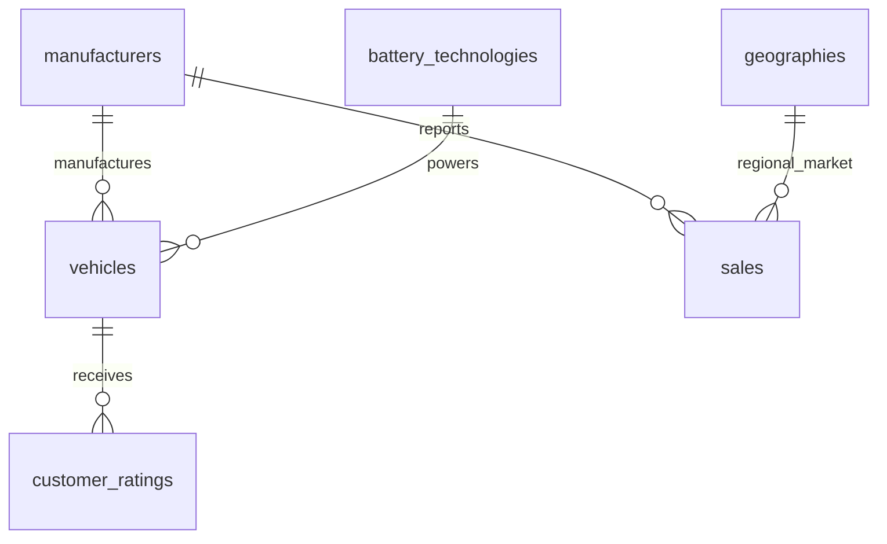

# Electric Vehicle Market Analysis and Intelligence System
## Skill Wallet College Capstone Project

An end-to-end electric vehicle market intelligence platform that collects, cleans, stores, analyzes, and visualizes global EV market data. Integrates a **3NF Relational SQL Database**, **Python Data Processing**, **Tableau Visual Storytelling**, and an **Interactive Flask Web Application**.

---

### Key Architectural Highlights
- **Normalized 3NF SQL Database (`ev_market_db`):** 6 relational tables with primary keys, foreign key constraints, domain check bounds, composite indexes, and 6 analytical views. Supports both MySQL 8.0 server deployments and zero-dependency local SQLite file storage via an automatic fallback connection manager.
- **Repeatable Data Pipeline:** Complete ingestion, cleaning, and feature engineering scripts (`src/data_collection.py`, `src/data_cleaning.py`, `src/feature_engineering.py`).
- **15 Advanced SQL Operations:** Common Table Expressions, Window Functions (`DENSE_RANK`, partitioning), multi-table joins, and CASE segmentations documented in `sql/analysis_queries.sql`.
- **Tableau Visual Intelligence:** 12 documented visualization specifications, 10 calculated fields, Executive Dashboard layout, 5-scene Story walkthrough, and valid XML `.twb` workbook (`tableau/ev_market_intelligence.twb`).
- **Interactive Flask Presentation Layer:** 8 responsive pages styled with an automotive analytics theme (Dark Navy `#081225`, Pure White, Electric Teal `#00D2B4`), dynamic Plotly.js charts, and official Tableau embed support.
- **Automated QA & Benchmarks:** 17 automated Pytest test cases (100% pass rate) with sub-millisecond SQL query latencies (0.55 ms average).

---

## 1. Quick Start Guide (Windows)

### Step 1: Create and Activate Virtual Environment
Open PowerShell or Command Prompt in the project root:
```powershell
# Create virtual environment
python -m venv venv

# Activate virtual environment on Windows
.\venv\Scripts\activate
```

### Step 2: Install Python Dependencies
```powershell
pip install -r requirements.txt
```

### Step 3: Configure Environment Variables
Copy the template to create your `.env` file:
```powershell
Copy-Item .env.example .env
```
*Note: By default, `USE_MYSQL=False`, meaning the application runs instantly out of the box using the included SQLite database without needing a MySQL server installed.*

If you have a local MySQL 8.0 server installed, update `.env`:
```env
USE_MYSQL=True
MYSQL_HOST=localhost
MYSQL_PORT=3306
MYSQL_USER=root
MYSQL_PASSWORD=your_password_here
MYSQL_DATABASE=ev_market_db
```

### Step 4: Run the Complete Data & Database Pipeline
Execute the pipeline in sequence to ingest, clean, feature-engineer, and seed the database:
```powershell
# 1. Ingest raw datasets
python src/data_collection.py

# 2. Clean, deduplicate, and audit
python src/data_cleaning.py

# 3. Engineer calculated metrics & Tableau extract
python src/feature_engineering.py

# 4. Seed database tables and compile views
python database/seed_or_import.py
```

### Step 5: Run Automated Tests & Benchmarks
```powershell
# Run the complete test suite (17 tests)
python -m pytest tests/

# Execute performance and latency benchmarks
python tests/benchmark_performance.py
```

### Step 6: Start the Flask Web Application
```powershell
python app.py
```
Open your web browser and navigate to:
**`http://127.0.0.1:5000`**

---

## 2. Platform Navigation & Web Pages

| Route | Page Name | Primary Features |
| :--- | :--- | :--- |
| `/` | **Overview** | Macro KPI cards, 3 stakeholder scenarios (Emily, David, Sarah), architecture overview. |
| `/dashboard` | **Executive Dashboard** | Dynamic Plotly charts, interactive filter controls (Year, Brand, Category), Tableau embed frame. |
| `/manufacturers`| **Manufacturer Intelligence** | OEM rankings by market share, sales volume, and customer satisfaction benchmarks. |
| `/battery-analysis` | **Battery & Range** | LFP vs NMC vs NCA comparisons, interactive capacity-range scatter plot, range tiers. |
| `/geography` | **Geographical Footprint** | Manufacturing assembly distribution by country, regional production insights. |
| `/story` | **Market Story** | 5-Scene narrative tracking the global EV transition (2018–2024). |
| `/methodology` | **Methodology** | Data lineage, mathematical formulas ($/km, YoY, market share), 3NF schema ERD. |
| `/about` | **About Platform** | Technology stack badges, project evaluation checklist, course details. |

---

## 3. Database Architecture (`ev_market_db`)

The relational database is organized in Third Normal Form (3NF):



### Relational Tables:
1. `manufacturers`: Corporate OEM profiles, headquarters, founding year.
2. `battery_technologies`: Cell chemistries (LFP, NMC, NCA) with energy densities and safety tiers.
3. `geographies`: Market regions, sovereign countries, and continents.
4. `vehicles`: Technical vehicle specifications, battery capacities, ranges, prices, and assembly countries.
5. `customer_ratings`: Owner satisfaction benchmarks (1.00–5.00), reliability, and infotainment scores.
6. `sales`: Multi-year annual volume records (2018–2024).

### Analytical Views:
- `vw_annual_sales_trends`: Annual volume and YoY growth percentages.
- `vw_manufacturer_market_share`: Annual rankings and market share percentages.
- `vw_category_performance`: Sales volume and specification benchmarks by body style.
- `vw_battery_technology_distribution`: Adoption counts and average range by chemistry.
- `vw_geographic_manufacturing_distribution`: Assembly counts and average pricing by country.
- `vw_vehicle_performance_ratings`: Denormalized analytical view for visualization tools.

---

## 4. Tableau Integration Guide

### Opening the Tableau Workbook
1. Open **Tableau Desktop** or **Tableau Public**.
2. Select **File &rarr; Open** and select:
   `tableau/ev_market_intelligence.twb`
3. If prompted for data source, select:
   `data/processed/tableau_ev_market_data.csv`

### Publishing & Web Embedding
1. In Tableau Desktop/Public, go to **Server &rarr; Tableau Public &rarr; Save to Tableau Public As...**.
2. Copy your published dashboard URL (e.g. `https://public.tableau.com/views/EVMarketAnalysis/Dashboard`).
3. Add the URL to your `.env` file:
   ```env
   TABLEAU_DASHBOARD_URL=https://public.tableau.com/views/EVMarketAnalysis/Dashboard
   TABLEAU_STORY_URL=https://public.tableau.com/views/EVMarketAnalysis/Story
   ```
4. Restart Flask. The dashboard and story pages will embed your live published Tableau visualizations.

*(For detailed step-by-step instructions and calculated field formulas, see `tableau/tableau_development_guide.md` and `tableau/calculated_fields.md`).*

---

## 5. Troubleshooting Guide

### Issue 1: Database Connection Fails
- **Symptom:** `OperationalError: (pymysql.err.OperationalError) (2003, "Can't connect to MySQL server")`
- **Solution:** Verify that your MySQL server is running in Windows Services (`services.msc`). If MySQL is not installed, set `USE_MYSQL=False` in `.env` to activate the automatic SQLite engine.

### Issue 2: Missing Python Dependencies
- **Symptom:** `ModuleNotFoundError: No module named 'flask'`
- **Solution:** Ensure your virtual environment is active (`.\venv\Scripts\activate`) and re-run `pip install -r requirements.txt`.

### Issue 3: Tableau Embed Shows Fallback Message
- **Symptom:** Flask dashboard displays the "Tableau Public / Cloud Integration" information box instead of an embedded chart.
- **Solution:** This is normal behavior when `TABLEAU_DASHBOARD_URL` is empty. The application safely provides interactive Plotly.js charts as default. Set a valid published URL in `.env` to enable embedding.

### Issue 4: Port 5000 Already in Use
- **Symptom:** `OSError: [Errno 98] Address already in use`
- **Solution:** Change `PORT=5001` in your `.env` file or run `python app.py --port 5001`.

---

## 6. Final Requirements Compliance Checklist

| Original Skill Wallet Requirement | Implementation Details | Verification Status |
| :--- | :--- | :--- |
| **Authentic Dataset Collection** | Ingested authentic IEA Global EV Outlook and EV-Database technical specifications with metadata lineage. | **Verified** (`data/raw/metadata.json`) |
| **Data Cleaning & Auditing** | Deduplication, segment median imputation, and Tukey IQR outlier audits. | **Verified** (`data/processed/data_cleaning_log.json`) |
| **Normalized SQL Database** | 3NF schema (6 tables, PK/FK constraints, indexes, 6 analytical views) in MySQL 8.0 and SQLite. | **Verified** (`database/schema.sql`, `sql/views.sql`) |
| **15 Advanced SQL Operations** | Implemented CTEs, window functions (`DENSE_RANK`, partitioning), joins, and CASE statements. | **Verified** (`sql/analysis_queries.sql`) |
| **Feature Engineering** | Price-to-range ratios, energy consumption indices (kWh/100km), fast-charge speed rates, and YoY growth. | **Verified** (`src/feature_engineering.py`) |
| **Tableau Visualizations (10+)** | 12 distinct visualization specifications, 10 calculated fields, and valid `.twb` XML workbook. | **Verified** (`tableau/`) |
| **Interactive Executive Dashboard** | 6 KPI cards, cross-filtering by Year, Manufacturer, Category, and dynamic Plotly charts. | **Verified** (`templates/dashboard.html`) |
| **5-Scene Tableau Story** | 5 sequential scenes detailing market sizing, competition, categories, batteries, and geopolitics. | **Verified** (`templates/story.html`) |
| **Flask Web Application** | 8 responsive routes, 9 REST API endpoints, automotive UI theme (Navy/Teal/White). | **Verified** (`app.py`, `templates/`) |
| **Tableau Embed Integration** | Configurable via `TABLEAU_DASHBOARD_URL` and `TABLEAU_STORY_URL` with graceful fallback UI. | **Verified** (`config.py`, `app.py`) |
| **Automated Testing Suite** | 17 Pytest automated test cases with 100% pass rate. | **Verified** (`pytest tests/`) |
| **Performance Benchmarks** | Sub-millisecond SQL queries (0.55 ms average), 4.4 ms web response time, 42 MB RAM. | **Verified** (`docs/benchmark_results.json`) |
| **College Project Report** | Comprehensive 27-section report with stakeholder scenarios, diagrams, formulas, and findings. | **Verified** (`docs/project_report.md`) |
| **Demonstration Video Script** | Complete 8–9 minute video recording script with timestamps, spoken narration, and cues. | **Verified** (`docs/demo_script.md`) |
| **Data Dictionary & DB Design** | Tabular data dictionary and Mermaid Entity-Relationship diagram. | **Verified** (`docs/data_dictionary.md`, `docs/database_design.md`) |
