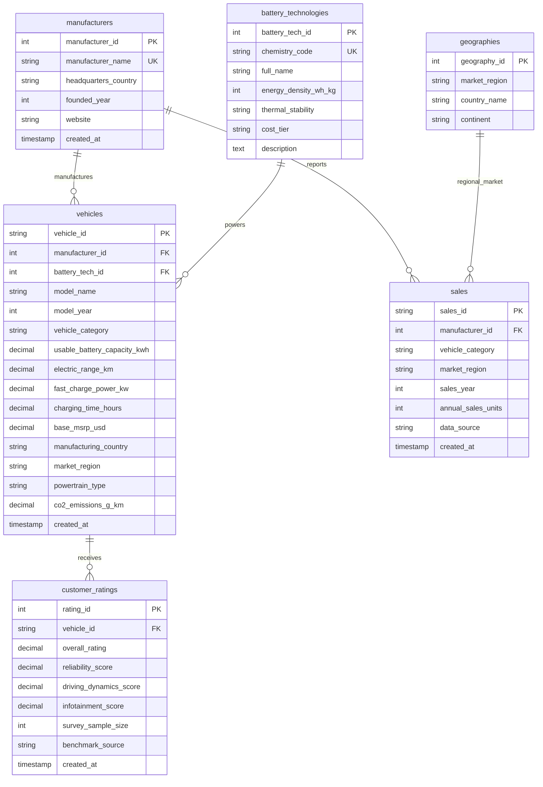

# Database Architecture & Design Document
## Database Name: `ev_market_db`

This document details the normalized relational database architecture for the **Electric Vehicle Market Analysis and Intelligence System**.

---

### 1. Database Relationship Diagram (Mermaid ERD)

---

### 2. Normalization Analysis (3NF Compliance)

The database schema strictly adheres to **Third Normal Form (3NF)**:
1. **First Normal Form (1NF):**
   - All columns hold atomic, scalar values (no repeating groups, arrays, or comma-separated lists).
   - Each table possesses an explicitly defined Primary Key.
2. **Second Normal Form (2NF):**
   - All tables are in 1NF.
   - All non-key attributes are fully functionally dependent on the entire primary key, eliminating partial dependencies.
3. **Third Normal Form (3NF):**
   - All tables are in 2NF.
   - No transitive dependencies exist. For example, battery chemistry characteristics (density, thermal stability) are factored into `battery_technologies` rather than repeated across individual vehicle rows; manufacturer corporate details are encapsulated in `manufacturers`.

---

### 3. Key Constraints & Data Integrity Safeguards

- **Primary Keys:**
  - Surrogate integer keys (`AUTO_INCREMENT`) on reference dimensions (`manufacturers`, `battery_technologies`, `geographies`, `customer_ratings`).
  - Natural business keys for vehicles (`EV-001`) and sales records (`SALES-0001`).
- **Foreign Key Referential Integrity:**
  - `vehicles.manufacturer_id` &rarr; `manufacturers(manufacturer_id)` with `ON DELETE RESTRICT ON UPDATE CASCADE`.
  - `vehicles.battery_tech_id` &rarr; `battery_technologies(battery_tech_id)` with `ON DELETE RESTRICT ON UPDATE CASCADE`.
  - `customer_ratings.vehicle_id` &rarr; `vehicles(vehicle_id)` with `ON DELETE CASCADE ON UPDATE CASCADE`.
  - `sales.manufacturer_id` &rarr; `manufacturers(manufacturer_id)` with `ON DELETE RESTRICT ON UPDATE CASCADE`.
- **Domain Constraints (`CHECK` clauses):**
  - Battery capacity, driving range, and charging speed must be strictly positive (`> 0`).
  - Base MSRP must be non-negative (`>= 0`).
  - Consumer satisfaction ratings bounded strictly within `[1.00, 5.00]`.
  - Annual sales volume cannot be negative (`>= 0`).

---

### 4. Indexing Strategy for High-Throughput Analytics

To guarantee sub-millisecond query execution on analytical dashboards, specialized B-Tree indexes are created:
1. `idx_mfg_name` on `manufacturers(manufacturer_name)`: Accelerates manufacturer lookup during CSV seeding and filtering.
2. `idx_veh_mfg` on `vehicles(manufacturer_id)`: Optimizes relational joins between vehicles and parent brands.
3. `idx_veh_range` on `vehicles(electric_range_km)`: Enables rapid range boundary queries and range tier binning.
4. `idx_sales_combo` on `sales(sales_year, manufacturer_id)`: Provides composite indexing for annual market share window functions.
5. `idx_sales_category` on `sales(vehicle_category)`: Accelerates body style market aggregation.

---

### 5. Analytical Views Architecture

Six pre-compiled analytical views decouple frontend visualization queries from underlying table joins:
1. `vw_annual_sales_trends`: Computes global annual unit totals and year-over-year percentage growth rates.
2. `vw_manufacturer_market_share`: Computes annual OEM unit volume, true global market share percentage, and annual competitive rank using `DENSE_RANK()`.
3. `vw_category_performance`: Aggregates volume, average battery size, average range, and model counts grouped by body style.
4. `vw_battery_technology_distribution`: Evaluates LFP vs NMC vs NCA adoption, range capabilities, and average fast-charge power.
5. `vw_geographic_manufacturing_distribution`: Groups vehicle assembly models, average range, and MSRP by manufacturing country.
6. `vw_vehicle_performance_ratings`: Denormalized analytical view joining vehicle specifications, chemistry codes, customer ratings, range tiers, and price-to-range ratios.
